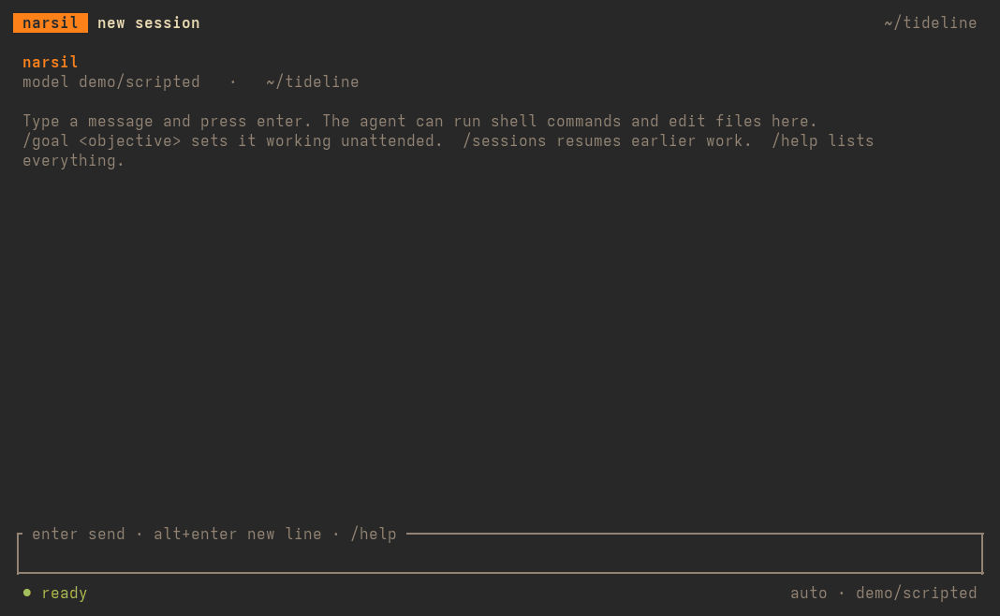

<h1 align="center">narsil</h1>

<p align="center">Just enough harness. A daemon that runs your agents, and a terminal UI that attaches to it.</p>

```sh
brew install AlexsJones/narsil/narsil && narsil setup
```

<p align="center">
  
</p>

<p align="center"><sub>One request, start to finish: the plan and two subagents at work, the files it touched, then the trace of each step, what it used, and a change of colours. A scripted session: <a href="docs/development.md#screenshots">how it is made</a>.</sub></p>

A model on its own forgets what it was doing when it stops, loses the thread when its context fills,
and cannot show you what it did. narsil supplies those three things and otherwise stays out of the
way: it works with any model, keeps what it knows in Markdown files you can open and edit, and when
it has something to say to the agent it prefers a line added to what the agent already sees over
another model call.

## Continuity

Work survives whatever interrupts it.

- Every step is on record before it runs, so a session can be stopped and resumed, comes back after
  a crash or a `kill -9`, and can work on a goal overnight with nobody at the keyboard.
- A larger task is a graph of work items with dependencies. Each is taken, done and closed with
  evidence, so a new session picks up where the last one stopped, without the old conversation.
- A question for you holds up only what depends on it. Answer it in its note and the goal carries on.

[Continuity](docs/continuity.md) · [Work and subagents](docs/work.md)

## Context cohesion

The agent starts each step with what bears on it, and without the rest.

- Memory is linked notes. Lessons and dead ends are written down as the work goes and put back in
  front of the agent before it tries the same thing twice.
- When a long conversation is compacted, the plan and its progress are still there on the other
  side. A subagent is handed its piece: the item, why it exists, and what it rests on.
- With an Obsidian vault, your own notes are the first place it looks, and the parts you close to
  it stay closed.

[Context cohesion](docs/context.md) · [Memory](docs/memory.md) · [Obsidian](docs/obsidian.md)

## Observability

You can see what it did, what it is doing, and whose work each line is.

- `narsil trace` prints the tree that was walked: each decision, the tools it led to, the time and
  the tokens. `/trace` shows it live.
- Every log line, status line and total names its session, subagent and goal the same way, so one
  id finds everything about a run: `narsil logs --session <id>`.
- Every request ends with what it used: calls, tokens in and out, how much was cached. `/usage`
  breaks it down, including what narsil itself adds to each call.
- The plan, who holds which item, and what each subagent is doing now are in the side panel. What
  the agent knows and what there is to do are files, not rows in a database you cannot read.

[Observability](docs/observability.md) · [The terminal UI](docs/tui.md)

## Install

```sh
brew install AlexsJones/narsil/narsil     # macOS and Linux
narsil setup                              # choose a backend, store the key, pick a model
narsil                                    # open the TUI in the current directory
```

Or from source: `cargo install --path .`. Later, `narsil update` brings it up to date and restarts the daemon.

```sh
narsil resume [id]                             # reopen an earlier session, with its history
narsil run "how many files are here?"          # one prompt, no TUI
narsil goal add "get the test suite passing"   # unattended work
```

## Documentation

| | |
| --- | --- |
| [Getting started](docs/getting-started.md) | Install, set up, the commands |
| [Configuration](docs/configuration.md) | The files you edit, models, permissions |
| [Continuity](docs/continuity.md) | Stop and resume, crashes, goals, sessions |
| [Work and subagents](docs/work.md) | The work graph, and handing parts of it out |
| [Memory](docs/memory.md) | What is remembered, when it is written, when it comes back |
| [Context cohesion](docs/context.md) | What is in front of the agent at each step, and what is kept out |
| [Obsidian](docs/obsidian.md) | Your vault as the first place to look; closing parts of it |
| [Local models](docs/local-models.md) | Which open models your machine can run an agent on, asked of llmfit |
| [Observability](docs/observability.md) | Traces, logs, status and totals |
| [The terminal UI](docs/tui.md) | Tabs, keys, commands, the side panel |
| [Development](docs/development.md) | Tests, and how a release is made |

Early software, built and tested on Linux. macOS builds are released but have had little use.

[MIT](LICENSE) licensed.

<p align="center">
  
</p>
