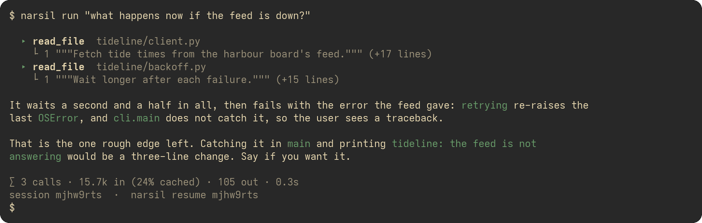

# Getting started

## Install

```sh
brew install AlexsJones/narsil/narsil     # macOS and Linux
```

or from source, with a Rust toolchain:

```sh
cargo install --path .                    # puts `narsil` in ~/.cargo/bin
```

Then:

```sh
narsil setup                  # choose a backend, store the key, pick a model, set permissions and sudo
narsil                        # open the TUI in the current directory
```

narsil talks to Anthropic directly, and to everything that speaks OpenAI-style chat completions:
OpenAI, Gemini, OpenRouter, DeepSeek, Mistral, Groq, xAI, and local servers such as llama.cpp,
Ollama, LM Studio and vLLM.

`narsil run` lays its output out for reading when it is on a terminal: each step the agent takes on
a line of its own with what it came to beneath, a request for your leave shown in full, and the answer
flowed to the window. Into a pipe or a file it writes the answer alone on standard output, as plain
text, with the steps on standard error.

## Updating

```sh
narsil update            # update narsil, then restart the daemon on the new version
narsil update --check    # only say whether there is a newer release
```

It updates narsil the way it was installed: `brew upgrade` if Homebrew put it there, `cargo install`
again from the same checkout or repository if cargo did, and for a binary downloaded from a release,
the latest release's binary for this machine, checked against the published checksums and swapped
in. The daemon is then restarted so that the new version is the one running: sessions and work in
flight are suspended and picked up again. `--no-restart` leaves the daemon as it is.

If narsil is updated some other way, `narsil restart` (or `/daemonrestart` in the TUI) does the
second half; the TUI and `narsil status` say when the daemon is older than the program on disk.

## Commands

<p align="center"></p>

<p align="center"><sub>One prompt from the shell: the steps, the answer, what it used, and how to go back to the session.</sub></p>

```sh
narsil start | stop | restart | status     # the daemon (the TUI starts it on demand)
narsil update [--check]                    # update narsil and restart the daemon
narsil -c                                  # continue the latest session in this directory
narsil resume [id]                         # pick an earlier session, or open one by id
narsil run "how many files are in this directory?"      # one prompt, no TUI
narsil goal add "get the test suite passing and keep it green"   # unattended work
narsil goal list | show | pause | resume | cancel
narsil memory list | add | search | rm | sync | restore
narsil work [item title]                    # this directory's work graph, or one item in full
narsil config path | show | edit [config|soul|agents]
narsil doctor                              # config, backend reachability, daemon, sudo
narsil trace [id]                          # the tree of what a session or goal did, with timings
narsil stats --since 24h                   # time and tokens per model, time and failures per tool
narsil usage [id]                          # tokens a session used: in, cached, out, by request
narsil service install                     # systemd user unit: restart on crash, start at login
```

Next: [configuration](configuration.md), [the terminal UI](tui.md).
