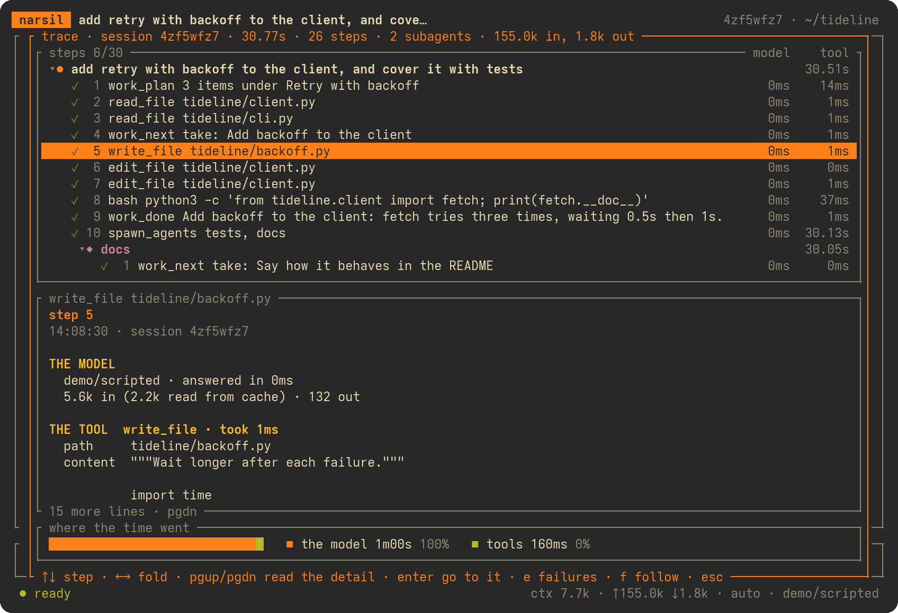
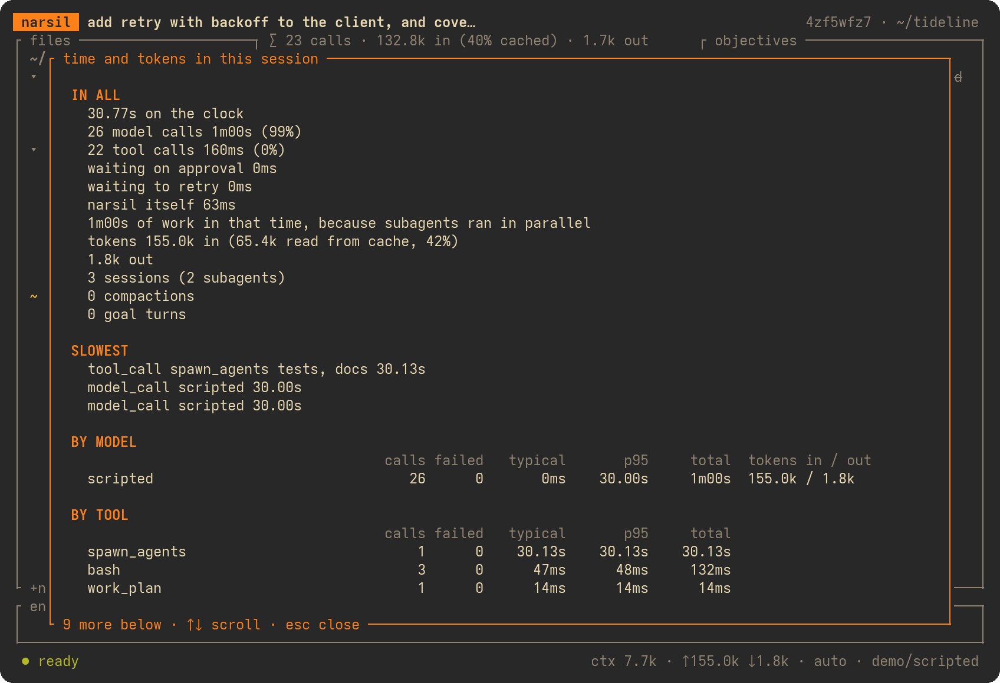
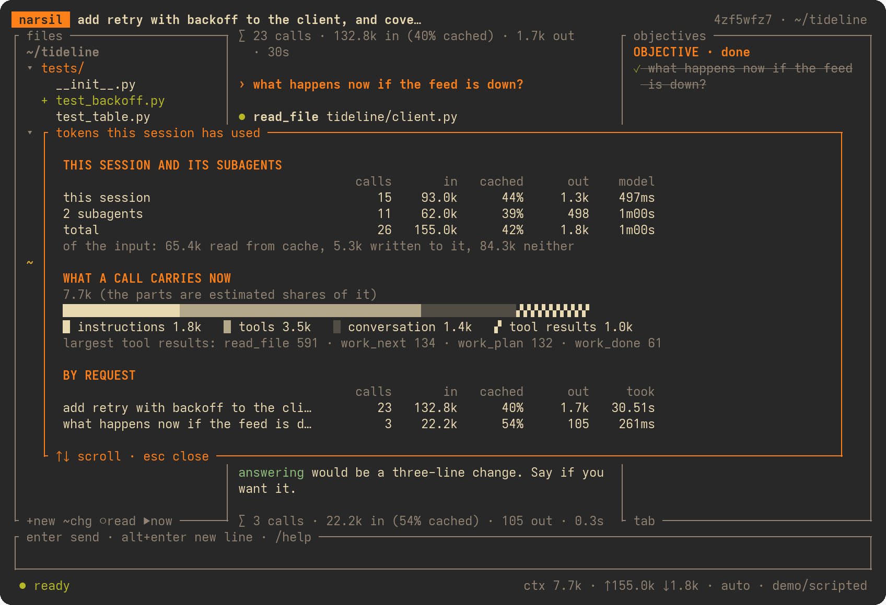
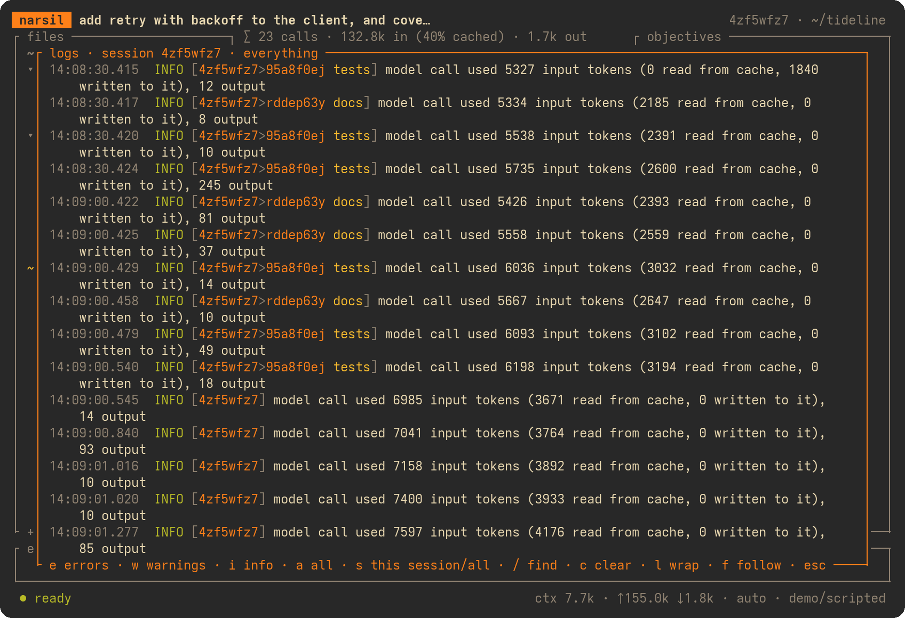

# Observability

Everything narsil does is recorded as it happens: each session run, model call, tool call,
compaction, wait for your approval, wait to retry, and goal turn, with its timing, what it ran
inside, and its details (tokens, time to the first token, the provider's request id, errors).

```sh
narsil trace              # the latest session; or: narsil trace <session or goal id>
```

<p align="center"></p>

<p align="center"><sub><code>/trace</code> in the TUI. Above, the steps: one line each, with how long the model took to ask for it and how long it took to do. Below, the step under the cursor in full. At the foot, where the time went.</sub></p>

In the window, up and down move through the steps; left and right shut and open a request or a
subagent; page up and down read on through the detail (what the tool was called with, what came
back, what the model said, its tokens); enter goes to the step in the conversation, opening the
subagent if it was one's; `e` leaves only what failed; `f` keeps to the latest step while the
session works.

As text:

```
● session c3hb › “Count the lines in one.txt and two.txt, then tell me the total.”      1.29s
├─ ◆ decides what to do next  [claude-haiku-5-5 · 4.8k in, 57 out]                      669ms
│  └─ ▸ bash wc -l one.txt two.txt  → 3 one.txt (+2 lines)                                3ms
└─ ◆ “The two files have 4 lines in total.”  [claude-haiku-5-5 · 4.9k in, 31 out]       586ms

1.29s on the clock · 2 model calls 1.25s (97%) · 1 tool calls 3ms (0%) · narsil itself 30ms
tokens 9.7k in (4.8k read from cache, 49%) · 88 out
```

It is the tree that was walked: each decision the model made with what it said, the tools it then
ran with what came back, and a subagent's whole run beneath the call that started it. `/trace` shows
the same inside the TUI.

| Command | What it gives |
| --- | --- |
| `narsil trace --timeline` | The same steps as a flat list in time order, with request ids |
| `narsil trace --flamegraph out.svg` | A flamegraph of where the time went; open it in a browser |
| `narsil trace --chrome out.json` | A trace for ui.perfetto.dev, one track per session |
| `narsil trace --folded` / `--json` | Folded stacks for other flamegraph tools; the raw records |
| `narsil stats --since 7d` | Totals over a period, per model and per tool; `/stats` in the TUI |
| `narsil usage [id]` | Tokens a session and its subagents used, by request and by model; `/usage` in the TUI |
| `narsil status` | What is in flight this moment: which session is in which model call or tool |
| `narsil logs -f` | The daemon log; `--session <id>` for one session or goal |

Because a step is recorded when it starts, not when it ends, whatever was running when the daemon
was killed is on record, and shows in the trace as cut off with how long it had run.

## Totals

`/stats` (and `narsil stats --since 7d` over a period) adds a session up: time on the clock and where
it went, tokens, the slowest steps, and a table by model and by tool.

<p align="center"></p>

## Tokens

What a session used is counted from one record: every request to a model that was answered, with
the tokens the backend said it used. Three views show it.

- **A receipt under each request**, once it is done, in the TUI and at the end of `narsil run`:

  ```
  ∑ 12 calls · 184.0k in (93% cached) · 3.1k out · 1m 42s
  ```

  The subagents that worked on the request are counted in it. The time is from the first call to the
  end of the last, tools and approvals included.
- **A running total in the status bar**: `↑368.0k ↓12.2k`, in and out, for the session and its
  subagents.
- **`/usage`** (and `narsil usage [id]`, with `--json` for a program): the session and its subagents
  apart and together, by model where more than one was used, by request, and what a call to the
  model carries now.

"In" is everything that was sent. A bill is made of three parts of it, which `/usage` gives apart:
what was read from the backend's cache, what was written to it, and what was neither. The share that
was read from cache is the percentage shown.

<p align="center"></p>

<p align="center"><sub><code>/usage</code></sub></p>

**What a call carries now** is the size the backend last reported for the conversation, shared out
among instructions, tool definitions, memory and work, conversation, and tool results. The size is
the backend's; the shares are estimated from the length of each part. Instructions and tools are
what narsil itself adds to every call.

### How far the figures can be trusted

They are the backend's own, read as each backend reports them, and backends differ in what they say:

| Backend | Read from cache | Written to cache | Reasoning |
| --- | --- | --- | --- |
| Anthropic | reported | reported | in the output |
| OpenAI, DeepSeek, Mistral, Groq | reported | not reported apart | in the output |
| OpenRouter | reported | reported, for models that charge for it | in the output |
| xAI | reported | not reported apart | left out of the output figure and counted in the total, so narsil takes it from the total |
| Gemini (OpenAI endpoint) | not documented | not documented | reported by users as left out of the output figure; taken from the total where the total says so |
| llama.cpp | reported (from the server's timings on older builds) | none | in the output |
| Ollama | in recent versions | none | in the output |
| vLLM | reported, when the server is started to say | reported | in the output |
| LM Studio | not documented | none | in the output |

Where a backend does not say how much was read from cache, the cached share shows as 0%, which
means "not reported", not "nothing was cached".

A figure with `~` before it is partly narsil's own estimate, made from the length of the text. That
happens in two cases: a server that reports no usage at all, and a server that reports a prompt far
smaller than it can have been, having counted only the part it had not cached (Ollama has done this
in several versions). In the second case narsil puts back what was left out, as read from cache.

Not counted: a request that failed or was interrupted before the backend said what it used.

Checked against the real thing with `tests/accuracy.rs` (see [Development](development.md)):
Anthropic, DeepSeek, xAI, llama.cpp and Ollama, call for call against what each sent, with
Anthropic's own token counter and llama.cpp's tokenizer agreeing on the size of every prompt. On xAI
every call's total was its prompt, its output figure and its reasoning added together, as its
documentation's example has it. The others are held to the shapes their documentation gives.

## One id finds everything

With several sessions, subagents and goals at work at once, everything narsil records says whose it
is, written the same way in the log, in `narsil status`, in `narsil stats` and in the trace:

| Written | Whose |
| --- | --- |
| `w31q3ky4` | a session |
| `w31q3ky4 goal:x6j4z062` | a goal's session |
| `w31q3ky4>9xk2m1aa count-two` | a subagent, after the session it works for |
| `goal:x6j4z062` | a goal, when no session is at work on it |

```
2026-11-26 14:38:47.168  INFO [w31q3ky4] model call used 1225 input tokens ...
2026-11-26 14:38:49.402 DEBUG [w31q3ky4>9xk2m1aa count-two] tool call finished tool=bash is_error=false bytes=5
2026-11-26 14:38:51.077  INFO [326aqdwe goal:2ftg7tes] goal is now completed: ok
```

```sh
narsil logs --session w31q3ky4        # one session's lines, its subagents' among them; -f follows
narsil logs --session 2ftg7tes        # or a goal's, by the goal's id
narsil trace w31q3ky4                 # the same id, for the tree of what it did
```

A session id can be given in short (`w31q`). Lines that belong to no session (the daemon starting,
the notes being re-read) carry no id. `narsil status` lists the sessions running and what each is
in the middle of, and `narsil stats` has a line per session beside the totals.

## The log

In the TUI, `/logs` opens the log in a window: this session's lines, with its subagents', following
as they are written. `e` shows errors only, `w` warnings and errors, `i` info and up, `a` everything;
`s` switches between this session and all of them; `/` finds text; `f` goes back to following.
Long lines are wrapped in full; `l` cuts them off at the edge instead, one line each.

<p align="center"></p>

<p align="center"><sub><code>/logs</code>: every line says whose it is, a subagent as <code>session&gt;subagent name</code>.</sub></p>
Each part of a line has its own colour: the time and the names of recorded values recede, the level
is green, yellow or red by how serious it is, the session id, a subagent's name and a goal's id each
stand out differently, and a line that reports trouble is tinted as a whole. `narsil logs` shows the
same colours on a terminal, and writes plain text into a pipe or a file.
`/logs errors` opens straight on the errors.

The log is leveled:

`[telemetry] level` sets how much is logged; `NARSIL_LOG=debug narsil start` overrides it for one
run, and accepts filters such as `info,narsil::provider=debug`. `log_format = "json"` writes one JSON
object per line. Recorded steps are kept for `keep_days`.

For CPU profiling, as opposed to time on the clock, build with the symbols a profiler needs:
`cargo build --profile profiling`, then `perf record -g target/profiling/narsil daemon`.

To record something new, give its span one of the names in `telemetry::RECORDED` (or add a name)
with `#[tracing::instrument]` or `tracing::info_span!`; see the top of `src/telemetry.rs`.

## What you can see without asking

- **The side panel** in the [TUI](tui.md): the goal, the work graph with who holds each item, and
  what each subagent is doing now.
- **The notes.** What the agent knows ([memory](memory.md)), what there is to do ([work](work.md)) and
  how a goal is going are Markdown files you can open, not rows in a database.
- **`◈`** in purple marks every call that touches your [Obsidian vault](obsidian.md).
