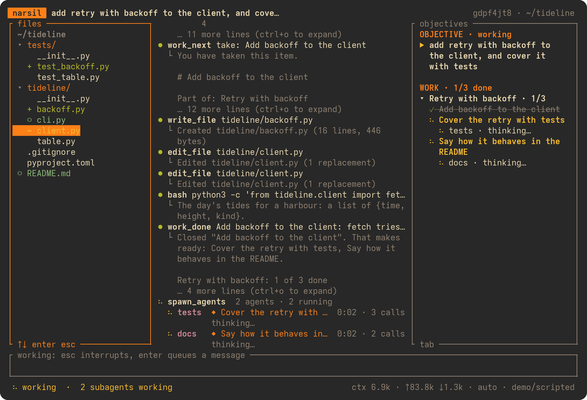
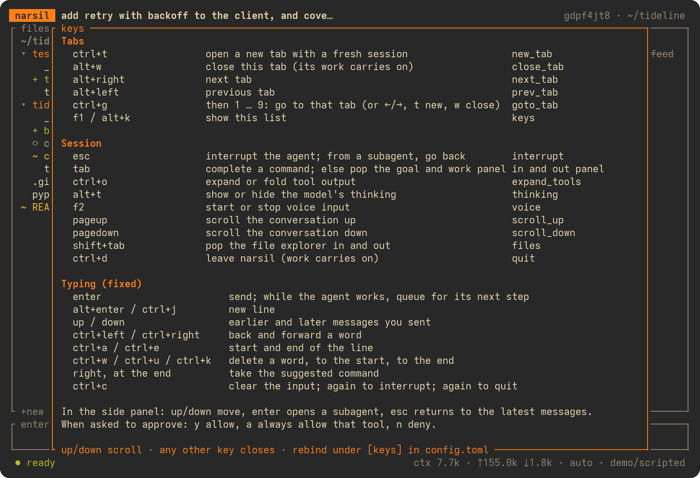
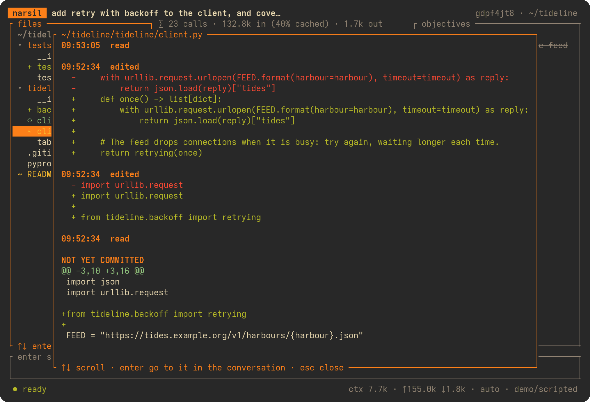
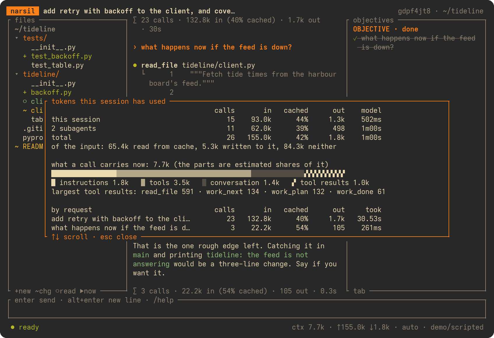
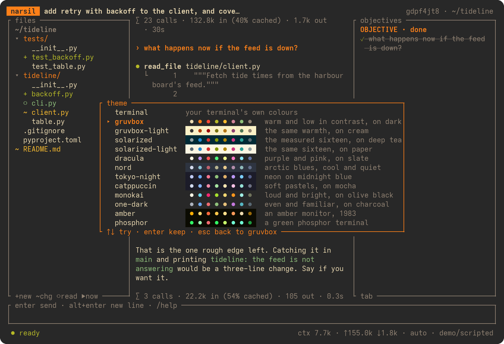

# The terminal UI

The screen is the conversation, with two panels that pop in and out beside it: the goal and its work
on the right, the file explorer on the left.

<p align="center"></p>

<p align="center"><sub>A request being worked on. Left, the files it has made (+), changed (~) and read (○). Right, the plan: one item done, two held by subagents.</sub></p>

## Keys

Every key in this table can be changed: see [Changing the keys](#changing-the-keys).

| Key | What it does | Name in `[keys]` |
| --- | --- | --- |
| tab | complete a slash command being typed; otherwise pop the goal and work panel in and out | `panel` |
| shift+tab | pop the file explorer in and out | `files` |
| esc | interrupt the agent (pauses the goal, in a goal's session); from a subagent, go back to its parent | `interrupt` |
| ctrl+t | new tab, with a fresh session | `new_tab` |
| alt+w | close this tab (its work carries on) | `close_tab` |
| alt+right / alt+left | next tab / previous tab | `next_tab` / `prev_tab` |
| ctrl+g then 1…9 | go to that tab; after ctrl+g, left/right, `t` and `w` also move between, open and close tabs | `goto_tab` |
| f1, alt+k | the list of key bindings as they are bound now | `keys` |
| pgup / pgdn | scroll the conversation | `scroll_up` / `scroll_down` |
| ctrl+o | expand or fold tool output | `expand_tools` |
| alt+t | show or hide the model's thinking | `thinking` |
| f2 | voice input | `voice` |
| ctrl+d | quit; the daemon and any running work continue | `quit` |

Fixed, for typing: enter sends (while the agent works, the message is queued for its next step);
alt+enter or ctrl+j is a new line; up and down walk through what you sent before; ctrl+a, ctrl+e,
ctrl+w, ctrl+u and ctrl+k edit the line as a shell does; ctrl+c clears the input, then interrupts,
then quits.

### Changing the keys

Add a `[keys]` section to `~/.config/narsil/config.toml` with the names from the table. Only what you
list changes; everything else keeps its default.

```toml
[keys]
files = "f3"                 # the explorer on f3 instead of shift+tab
new_tab = "ctrl+n"
keys = "f1 alt+k f9"         # several keys for one action, separated by spaces
goto_tab_with = "alt"        # alt+1…9 go straight to a tab, where your terminal passes them on
```

A binding is modifiers (`ctrl`, `alt`, `shift`) and a key, joined by `+`: a letter or digit, or
`enter`, `esc`, `tab`, `space`, `up`, `down`, `left`, `right`, `pageup`, `pagedown`, `home`, `end`,
`backspace`, `delete`, `insert`, `f1` to `f12`. `/reload` does not re-read keys: they are read when
the TUI starts. A binding that cannot be read keeps its default and is reported when the TUI opens,
as is a key bound to two actions. The keys window (`f1`, or `/keys`) always shows what is in force.

<p align="center"></p>

<p align="center"><sub>The keys window, with the name each binding has in <code>[keys]</code>.</sub></p>

Going to a tab by number takes two keystrokes because terminals keep the one-stroke versions for
themselves: Ptyxis, GNOME Terminal and Ghostty all use alt+1…9 for their own tabs.

The two panels share the window with the conversation: both show side by side from 80 columns up,
taking more as the window widens. In a narrower window the one you asked for last stays.

## Tabs

Each tab is a session of its own with its own connection to the daemon, and they all work at once.
The tab bar appears with the second tab. A tab shows a spinner while it works, `!` when it is waiting
for an approval, and `•` when it has finished since you last looked. Plain `narsil` opens a new
session; `narsil resume <id>` (printed for every tab when you leave) reopens one with its history.

## The goal and work panel

On the right. It appears when there is something to show, and `tab` pops it out and back in.

- **The objective.** A goal, with its status and turn. Or, with no goal set, the last thing you asked
  for that narsil acted on: `▶` while it works on it, ticked and struck through when it is done,
  and replaced when you ask for the next thing. A question that is simply answered sets no objective
  and leaves the last one standing.
- **The work**, when it has been laid out as a plan: the graph of items (✓ done and struck through,
  ▶ in progress, ○ ready, · blocked, ? waiting on you) with the subagents holding each one. A plan
  made for something asked in passing hangs under the request, and then stands for it. Plans that
  are finished leave the panel when you ask for the next thing; they stay on record.
- **Subagents** holding no item, and recorded milestones.

With the keyboard in it, up and down move through the items and the conversation follows, jumping to
where each was last touched; enter opens a subagent; esc returns to the end of the conversation. A
session's panel holds what is unfinished here and what that session itself worked on. `/cleargoal`
empties it.

## The file explorer

On the left, `shift+tab`. It is for keeping an eye on what narsil is doing to a directory: the folder
this session works in, as a tree, opened wherever narsil has been.

| Mark | Meaning |
| --- | --- |
| `▶` | being read or written this moment |
| `+` | made by narsil in this session |
| `~` | changed by narsil; dimmer, changed on disk during the session by something else, such as a command it ran |
| `○` | read |

A folder that is shut still shows the mark of what happened inside it. What git ignores (build
output, dependencies) is left out, except where narsil went. Files it touched outside this directory
are listed at the bottom, in grey, under ELSEWHERE. The tree follows `/cd`.

With the keyboard in it, up and down move, enter (or right) opens and shuts a folder, left goes up.
Enter on a file opens a window on **what narsil has done to that file**: each read, edit and write,
latest first, with what an edit took out and put in, and below that what stands changed in the file
against git. From there enter goes to that step in the conversation, and esc closes the window.

<p align="center"></p>

<p align="center"><sub>Enter on a file: every read and edit narsil made to it, latest first, and what stands uncommitted.</sub></p>

## Tokens

When a request is done, a line under it says what it used: the calls to the model, the tokens in
(and how much of that was read from cache), the tokens out, and how long it took. The status bar
keeps the running total for the session and its subagents, as `↑in ↓out`. `/usage` opens the whole
account: by request, by model, and what a call carries now. A `~` marks a figure that is partly
narsil's estimate. [Observability](observability.md#tokens) says how the figures are arrived at.

<p align="center"></p>

<p align="center"><sub><code>/usage</code>. Behind it, the line under each request saying what it used; bottom right, the running total.</sub></p>

## Themes

`/theme` opens the list of colour themes. Moving over one puts it in force, so the whole screen shows
what it would be; enter keeps it, esc goes back to the one you had. The choice is saved as `theme`
under `[tui]` in `config.toml`, and `/theme gruvbox` sets one directly.

<p align="center"></p>

<p align="center"><sub><code>/theme</code>: each theme with its colours. The one under the cursor is in force as you move.</sub></p>

| Theme | |
| --- | --- |
| `terminal` | your terminal's own colours (the default) |
| `gruvbox`, `gruvbox-light` | warm and low in contrast, on dark or on cream |
| `solarized`, `solarized-light` | the measured sixteen, on deep teal or on paper |
| `dracula` | purple and pink, on slate |
| `nord` | arctic blues |
| `tokyo-night` | neon on midnight blue |
| `catppuccin` | soft pastels, on mocha |
| `monokai` | loud and bright, on olive black |
| `one-dark` | even and familiar, on charcoal |
| `amber`, `phosphor` | an amber monitor and a green phosphor terminal |

A theme sets what everything stands on as well as the colours, so it looks the same whatever the
terminal's own palette is. On a terminal without 24-bit colour the nearest of 256 colours are used.

## Commands

Slash commands complete as you type: the rest of the best match shows dimmed, tab or the right arrow
takes it, and more tabs walk through the others. After `/cd`, tab completes folder names the same way.

`/new` `/clear` `/sessions` `/resume <id>` `/continue` `/compact` `/goal <objective>` `/goals`
`/pause` `/cleargoal` `/agents` `/back` `/cd <dir>` `/files` `/panel` `/model [text]`
`/provider [name]` `/memory [query]` `/remember <text>` `/forget <id>` `/trace` `/stats` `/usage`
`/logs [errors]` `/theme [name]` `/keys` `/auto` `/ask` `/reload` `/daemonrestart` `/title <text>`
`/help`.

`/daemonrestart` stops the daemon and starts it again with the narsil program as it is on disk now
(after an update, say), and gives every open tab a new connection with its session taken up again.
Work that was in flight is suspended: goals pick up by themselves, a chat with `/continue`.

## Voice

Voice goes through commands you choose, so any recorder and speech-to-text engine can be used:

```toml
[voice]
enabled = true
record_command = "pw-record --rate 16000 --channels 1 {file}"
transcribe_command = "whisper-cli -m ~/models/ggml-base.en.bin -f {file} -nt -np"
speak_command = ""          # optional text-to-speech; receives each reply on stdin
```

F2 starts recording, F2 again stops it and puts the transcript in the input box.
