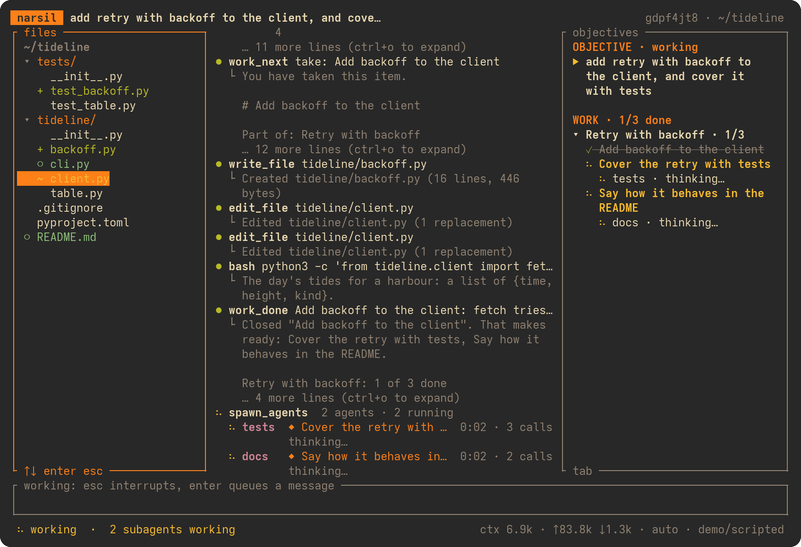

# Work and subagents

<p align="center"></p>

<p align="center"><sub>The plan for a request, on the right: one item done and struck through, two in the hands of subagents working at once.</sub></p>

## The work graph

Work that takes more than a couple of steps is laid out as items that depend on each other, and that
graph, not the conversation, is what carries a long task. It survives compaction, restarts, subagents
and separate sessions.

One item is one note, beside the memory notes (`~/.local/share/narsil/work/<project>/`, or
`narsil/Work/<project>/` in an Obsidian vault):

```markdown
---
id: w-7c2e1
status: open            # open | in_progress | done | dropped | waiting
parent: ["[[Personal website live]]"]
blocked_by: ["[[Employment history gathered]]", "[[Site scaffold builds locally]]"]
project: /home/me/Code/personal-site
---
Every employer appears on /work with role, dates and one line on what I did.

## Done when
- The build passes and /work shows one entry per employer

## Result
(what was done, where it is, and the evidence, once it is closed)

## Log
- 2026-11-27 01:12 · created (session k3f9m2xa)
```

- **Ready** means open, with nothing it is blocked by still open. "What can be done now?" is a query
  over the graph, not something the model has to remember.
- The agent lays work out with `work_plan`, asks `work_next` what is ready and takes an item, and
  closes it with `work_done`, which requires a result and evidence. Taking an item hands over what
  it rests on: the results of the items it depended on. Work found along the way is filed as a
  follow-up instead of being done on the spot or forgotten.
- Something only you can settle is a **question** item. It waits for you while everything that does
  not depend on it carries on.
- A subagent can be given a ready item: it takes it before it starts, so no two agents hold the same
  one, and the item is released if the subagent ends without closing it.
- The notes are the source of truth. Answer a question by setting its `status: done` and writing the
  answer under `## Result`; drop an item with `status: dropped`; add work by writing a note. The
  daemon notices within about 20 seconds.
- A new session in the same directory is told where the work stands, and finished items record what
  was done and how it was checked; `work_next` with `show` reads any of them. A session is also told
  what was finished in other directories, so it can read how something similar went before.
- Work is filed by directory. When a task is about a directory other than the one narsil was started
  in, the agent moves the session there first (`change_directory`, or `/cd`), so the plan and the
  project's memory sit with the work.

`narsil work` prints the graph for the current directory; the TUI side panel shows it live.

## Without a goal

Work does not have to be given as a goal to be laid out. Ask for something in passing ("build me a
game for the browser") and, once the agent is on its third file with no plan, narsil tells it to make
one. The plan hangs under what you asked for, as a goal's does under its objective, and shows in the
side panel with its progress. A one-file fix never sees any of this.

`/cleargoal` clears the panel when you are done with a plan or have changed your mind: what is
unfinished in this directory is dropped (and this session's goal cancelled, if it has one), and what
was done stays on record as done. `narsil work --clear` does the same from the shell.

## Subagents

The agent decides when to hand independent pieces of work to subagents, and can give each a ready
work item to take. `[agents] max_parallel` (default 4) run at once, in the order given; the rest queue.
`[model] subagent` gives them a different model from the session's.

You see them as they work:

- **In the conversation**, the `spawn_agents` call is a live roster: one row per subagent with its
  state (queued, running, done, failed, interrupted), its work item (marked ◆) or task, time worked
  and tool calls, and beneath it what it is doing right now or how its report begins.
- **In the side panel**, each subagent sits under the work item it holds, and that item spins while
  someone is working on it. Subagents holding no item are listed under AGENTS.
- **The status line** counts the subagents working and queued.

Select one in the panel and press enter (or use `/agents`) to open its own transcript and watch it
live. There, esc returns to the parent, a message you send is delivered at its next step, and `/pause`
stops that one subagent while the others carry on. All of this survives closing the TUI, `narsil
stop`, and a crash: the roster is read back from the store.
